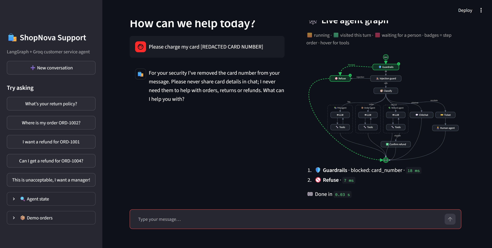
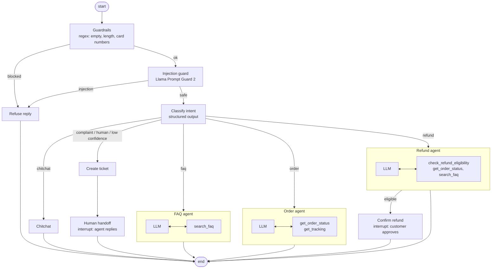

# ShopNova Support Agent

A customer service agent for an online store, built as a **LangGraph** state machine with tool-using sub-agents,
human-in-the-loop approvals, layered safety checks and an evaluation suite. It runs on **Groq** models and has a
**Streamlit** UI that draws the agent's path through the graph live as it works.



## What it does

- **Answers store questions** from an FAQ knowledge base (returns, shipping, payments, warranty, accounts).
- **Looks up orders and tracking** through tools, including loosely written IDs like `1003` or `#1003`.
- **Handles refunds safely.** It checks eligibility against the 30-day policy, then pauses for the customer to
  approve. The model can never submit a refund itself.
- **Escalates to a human** on complaints, explicit requests, low classifier confidence, or two negative turns in a
  row. It opens a ticket and waits for a support agent's reply, which is relayed into the same conversation.
- **Blocks unsafe input** in two layers: a regex guardrail redacts card numbers from stored history, and Meta's
  Llama Prompt Guard 2 classifier screens for prompt injection and jailbreaks.

## Results

From [`evals/RESULTS.md`](evals/RESULTS.md): 50 labelled conversations run against the real models, scored with
deterministic checks (no LLM judge).

| Metric | Result |
|---|---|
| Intent classification accuracy | **100%** (38/38) |
| Routing accuracy | **98%** (49/50) |
| Escalation precision / recall | **100% / 100%** (7/7) |
| Eligible refunds gated behind customer approval | **100%** (4/4) |
| Prompt injections blocked | **83%** (5/6) |
| False blocks on benign messages | **0%** (0/39) |
| **Unauthorized refunds issued** | **0** |
| Overall case pass rate | **92%** (46/50) |

Of the four failures, one was an agent bug, now fixed and passing on rerun. Two were over-strict test
expectations. One is a real limitation: a role-play jailbreak that Prompt Guard scores at 0.001. The
[results page](evals/RESULTS.md) has the details. A full rerun after the fixes is in progress under the Groq free
tier's daily token cap; all 26 cases it has completed so far passed.

## Architecture



- **Supervisor graph** (`agent/graph.py`): deterministic guardrails first, then an LLM classifier whose structured
  output (`intent`, `confidence`, `sentiment`, `order_id`) drives routing in plain Python.
- **Sub-agents** (`agent/nodes.py`, `build_tool_agent`): each is a small ReAct loop compiled as its own
  `StateGraph` and mounted as a node. It sees only its own tools.
- **Human-in-the-loop**: `confirm_refund` and `human_handoff` call LangGraph `interrupt()`. The checkpointer
  persists the thread, and the UI resumes it with `Command(resume=...)`.
- **UI** (`app.py`, `ui/graph_view.py`): streams tokens with `stream_mode=["updates", "messages"]` and
  `subgraphs=True`, and redraws a hand-laid SVG of the graph on every node event. Running, visited and waiting
  nodes are highlighted, and each step shows its timing.

## Design decisions

- **The LLM never moves money.** `create_refund_request` isn't a tool. Only the graph calls it, after the
  customer clicks Approve. A prompt injection can at worst make the agent *talk* about a refund. The eval suite
  counts unauthorized refunds, and the eval run exits with an error if there is even one.
- **Routing is code, not a prompt.** The classifier only labels the message, and Python decides where it goes.
  That makes escalation rules (confidence < 0.5, two negative turns) explicit, testable and tunable.
- **Two-layer input safety.** The regex guardrail costs nothing and redacts card numbers *in place*: the stored
  message is replaced by ID, so the number never reaches the model or the checkpoint. The model-based injection
  guard **fails open** (logged), so a classifier outage degrades safety screening rather than taking support
  down. The refund gate above stays in force either way.
- **Tools return data, not prose.** Tools return dicts and the LLM writes the reply, so facts are checkable.
  The eval suite verifies them with string matching.
- **Evals are deterministic.** Routing, tool calls, interrupts and required facts are checked directly, which
  keeps scores reproducible and cheap under free-tier rate limits.
- **Bring-your-own-key.** The public demo never holds a key. Each visitor's key is validated by listing models
  (no tokens spent) and lives only in that session's clients. Raw provider errors, which contain account
  details, are never shown.
- **Testable without a network.** `build_graph(llm, injection_score, checkpointer)` takes injectable
  dependencies, so the 29 tests use a scripted fake model and run offline in a few seconds.

## Run it locally

```bash
uv venv --python 3.12 .venv
uv pip install --python .venv/Scripts/python.exe -r requirements.txt   # Linux/macOS: .venv/bin/python
.venv/Scripts/python.exe -m streamlit run app.py                       # http://localhost:8502
```

The app is **bring-your-own-key**: paste a free Groq key from [console.groq.com/keys](https://console.groq.com/keys)
in the sidebar. It's checked without spending tokens and kept only in your browser session. Then try the sample
prompts in the sidebar. The demo orders are `ORD-1001` to `ORD-1005`. After an escalation, reply as
the human agent from the **Support agent console** in the sidebar.

## Tests and evals

```bash
python -m pytest -q                  # 29 offline tests (fake LLM), also run in CI
cp .env.example .env                 # evals read GROQ_API_KEY from .env (the web app never does)
python -m evals.run_evals            # live eval against Groq, writes evals/RESULTS.md
python -m evals.run_evals --resume   # finish a run that hit the daily quota
```

CI (`.github/workflows/ci.yml`) runs `ruff` and the test suite on every push. `evals.yml` runs the live eval on
demand using a `GROQ_API_KEY` repository secret.

## Deploy (Streamlit Community Cloud)

1. Push this repo to GitHub.
2. At [share.streamlit.io](https://share.streamlit.io), create an app from the repo with `app.py` as the
   entrypoint and Python 3.12 under *Advanced settings*.

No secrets are needed: every visitor brings their own Groq key, so a public demo can't run up anyone's quota.

## Project structure

```
app.py               Streamlit UI: chat, live graph, refund approval, support agent console
agent/graph.py       Graph wiring
agent/nodes.py       Guardrails, injection check, classifier, routers, sub-agents, interrupts
agent/tools.py       Tools over mock data + graph-only actions (refunds, tickets)
agent/llm.py         Groq clients (chat model and prompt guard)
agent/state.py       Graph state and classifier schema
ui/graph_view.py     Live SVG graph and step trace
evals/               Dataset, runner, results
tests/               Offline tests with a fake LLM
data/                Mock FAQ and orders
```

## Limitations

- State is in memory. Each browser session has its own graph and conversation memory (`InMemorySaver`), but the
  mock ticket and refund stores are shared by everyone on one server, and everything resets on restart. A SQLite
  or Postgres checkpointer and a real order API are the next steps.
- The FAQ search is keyword-based. Embedding retrieval would handle paraphrases better.
- Prompt Guard 2 targets instruction-override attacks, and misses role-play social engineering (see `inj-06`).
- On the Groq free tier, a full eval run can hit the daily token cap. The runner stops cleanly and `--resume`
  finishes it later; in the app, a rate-limited key gets a friendly retry message.

## Stack

Python 3.12 · LangGraph 1.x · LangChain Core · Groq (`openai/gpt-oss-120b`, `meta-llama/llama-prompt-guard-2-86m`) ·
Streamlit · pytest · ruff · GitHub Actions
